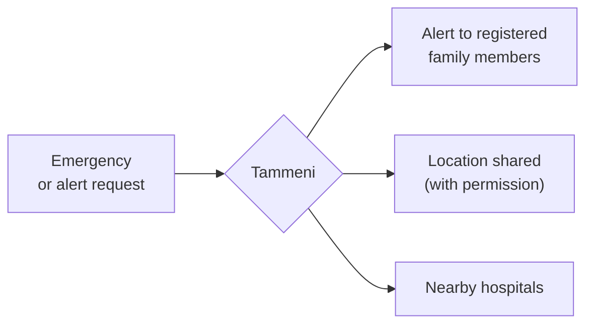

<h1>طمني &nbsp;·&nbsp; Tammeni</h1>

<b>Elderly Care App</b> 
Helping families stay connected with and monitor the well-being of elderly family members.

  
  

---

## Table of Contents

- [Project Overview](#project-overview)
- [Problem Statement](#problem-statement)
- [Main Features](#main-features)
- [How It Works](#how-it-works)
- [Project Goals](#project-goals)
- [Project Status](#project-status)
- [Important Note](#important-note)
- [Team Members](#team-members)
- [Work Plan](#work-plan)
- [KPIs](#kpis)

---

## Project Overview

**Tammeni** is a proposed application designed to help families stay connected with and monitor the well-being of elderly family members.

| | |
|---|---|
| **Project** | Tammeni (طمني) |
| **Type** | Elderly care app |
| **Purpose** | Keep families connected with, and aware of, the well-being of their elderly relatives |
| **Stage** | Planning and development |

---

## Problem Statement

Family members may worry about elderly parents when they are alone, or when an emergency occurs and no one is nearby to help.

| Situation | The concern |
|---|---|
| **A parent is alone** | The family cannot know how they are doing. |
| **An emergency occurs** | No one is nearby to help, and the family may not find out in time. |

---

## Main Features

| # | Feature | Description |
|:-:|---|---|
| 1 | **Emergency alerts** | Alerts are sent to registered family members. |
| 2 | **Health emergency notifications** | Notifications are sent when potential health emergencies are detected by compatible devices or sensors. |
| 3 | **Family contact management** | Manage the family members who receive alerts. |
| 4 | **Nearby hospital finder** | Assistance in finding nearby hospitals. |
| 5 | **Emergency location sharing** | Emergency location information can be shared, with appropriate user permission. |

---

## How It Works

A simplified view of the planned flow:

---

## Project Goals

| Goal | Description |
|---|---|
| **Faster response** | Help families respond more quickly to potential emergencies. |
| **Better communication** | Improve communication between elderly people and their families. |
| **Easier access to care** | Make it easier to locate nearby medical facilities. |

---

## Project Status

This project is currently in the **planning and development stage**. Features will depend on the selected technologies, available devices and testing.

---

## Important Note

> **Tammeni is intended as a family support tool.** It is not a substitute for professional medical diagnosis or emergency services.

---

## Team Members

| Member | Role |
|---|---|
| **Mostafa Adel Mostafa** | Team Leader |
| Batoul Abdullah Ali | Team Member |
| Ziad Ibrahim Mohamed | Team Member |
| Hana Mostafa Mahmoud | Team Member |
| Mohamed Ismail Abdelmawgoud | Team Member |

---

## Work Plan

| Step | Activity |
|:-:|---|
| 1 | Define the project problem and objectives |
| 2 | Conduct market research and competitor analysis |
| 3 | Identify the target audience and its needs |
| 4 | Develop the project strategy and positioning |
| 5 | Prepare the required project documentation and presentation |

---

## KPIs

| # | KPI |
|:-:|---|
| 1 | Complete the planned project milestones on time |
| 2 | Complete the market research and competitor analysis |
| 3 | Clearly define the target audience |
| 4 | Complete the project strategy and documentation |

---

**Tammeni · طمني**

## Instructor

Youssef Abdelsabour

## link
https://drive.google.com/drive/folders/1sFM79Zl0UdnIgdrJUB6P0gkBe3Um0Mrw
