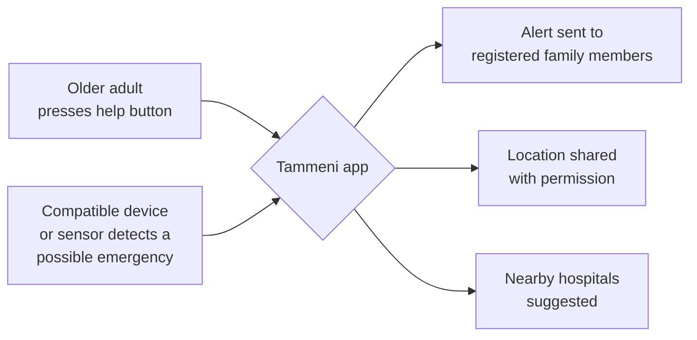

# Tammeni · طمني

### Elderly care and family coordination app

*Stay close to the ones you love, even when distance gets in the way.*

---

## Table of Contents

1. [Project Overview](#1-project-overview)
2. [Problem Statement](#2-problem-statement)
3. [Main Features](#3-main-features)
4. [How It Works](#4-how-it-works)
5. [Project Goals](#5-project-goals)
6. [Project Status](#6-project-status)
7. [Team](#7-team)
8. [Work Plan](#8-work-plan)
9. [KPIs](#9-kpis)
10. [Social Media Snapshot](#10-social-media-snapshot)
11. [Important Note](#11-important-note)

---

## 1. Project Overview

**Tammeni** (طمني, “put my mind at ease”) is a proposed application that helps families stay connected with elderly relatives and keep an eye on their well-being, even when they live far apart.

| | |
|---|---|
| **Concept** | Elderly care and family coordination app |
| **Audience** | Adult sons and daughters, family caregivers, and older adults |
| **Market** | Egypt |
| **Languages** | Arabic and English |
| **Stage** | Planning and development |

---

## 2. Problem Statement

Family members worry about elderly parents when they are alone, and especially when an emergency happens and **no one is nearby to help**. Calling every hour is not realistic, and not knowing is stressful for everyone.

| Who | The challenge |
|---|---|
| **Sons and daughters** | They cannot tell, at any moment, whether a parent is safe, and they fear an emergency while they are at work or abroad. |
| **Family caregivers** | Someone has to know who is checking on the parent and when. |
| **Older adults** | They want independence and dignity, and a simple way to ask for help. |

---

## 3. Main Features

| # | Feature | What it does |
|:-:|---|---|
| 1 | **Emergency alerts** | Sends an alert to every registered family member when help is needed. |
| 2 | **Health emergency notifications** | Notifies the family when a potential health emergency is detected by compatible devices or sensors. |
| 3 | **Family contact management** | Lets the family keep and manage the list of people who receive alerts. |
| 4 | **Nearby hospital finder** | Helps users find nearby hospitals and medical facilities. |
| 5 | **Emergency location sharing** | Shares emergency location information, with the user’s permission. |

> **Note:** Features depend on the technologies selected, the devices available and the results of testing.

---

## 4. How It Works

A simplified view of the planned alert flow:

---

## 5. Project Goals

| Goal | Outcome we aim for |
|---|---|
| **Faster response** | Help families respond more quickly to potential emergencies. |
| **Better communication** | Improve communication between elderly people and their families. |
| **Easier access to care** | Make it easier to locate nearby medical facilities. |

---

## 6. Project Status

| Area | Status |
|---|---|
| **Overall** | Planning and development stage |
| **Features** | Not final. They depend on the selected technologies, available devices and testing. |
| **Milestone 1** | Project definition, research, audience and strategy |
| **Milestone 2** | Content strategy, publishing on social media, and ads (report prepared) |

---

## 7. Team

| Member | Role | Focus |
|---|---|---|
| **Mostafa Adel Mostafa** | Team Leader | Strategy, coordination and final review |
| Batoul Abdullah Ali | Content | Content plan, Arabic captions and scripts |
| Ziad Ibrahim Mohamed | Publishing and community | Posting, replies and publishing record |
| Hana Mostafa Mahmoud | Design | Visual identity and post designs |
| Mohamed Ismail Abdelmawgoud | Paid ads | Campaign setup, monitoring and analysis |

---

## 8. Work Plan

| Step | Activity | Output |
|:-:|---|---|
| 1 | Define the project problem and objectives | Problem statement and objectives |
| 2 | Conduct market research and competitor analysis | Research and competitor report |
| 3 | Identify the target audience and its needs | Audience profiles |
| 4 | Develop the project strategy and positioning | Strategy and positioning document |
| 5 | Prepare the project documentation and presentation | Milestone reports and presentation |

---

## 9. KPIs

| KPI | How it is measured |
|---|---|
| **Milestones on time** | Planned project milestones completed by their deadlines |
| **Research completed** | Market research and competitor analysis finished |
| **Audience defined** | Target audience clearly described and documented |
| **Strategy and documentation** | Project strategy and documentation completed |

---

## 10. Social Media Snapshot

Figures from the Milestone 2 report, taken at the time of capture.

| Platform | Audience | Notes |
|---|---|---|
| **Facebook** | 179 followers, 10 posts | First post on 18 November 2026 |
| **Instagram** | 1 follower, 7 posts | 574 views in the last 30 days |
| **Campaign 1 (Facebook ad)** | 859 page visits | EGP 1.01 per visit, EGP 867 total, 6 days |

---

## 11. Important Note

> **Tammeni is a family support tool.** It is not a substitute for professional medical diagnosis or emergency services. In an emergency, contact the emergency services (ambulance in Egypt: **123**).

---

**Tammeni · طمني** &nbsp;|&nbsp; Milestone 02 &nbsp;|&nbsp; Egypt, 2026

## Instructor

Youssef Abdelsabour

## link
https://drive.google.com/drive/folders/1sFM79Zl0UdnIgdrJUB6P0gkBe3Um0Mrw
